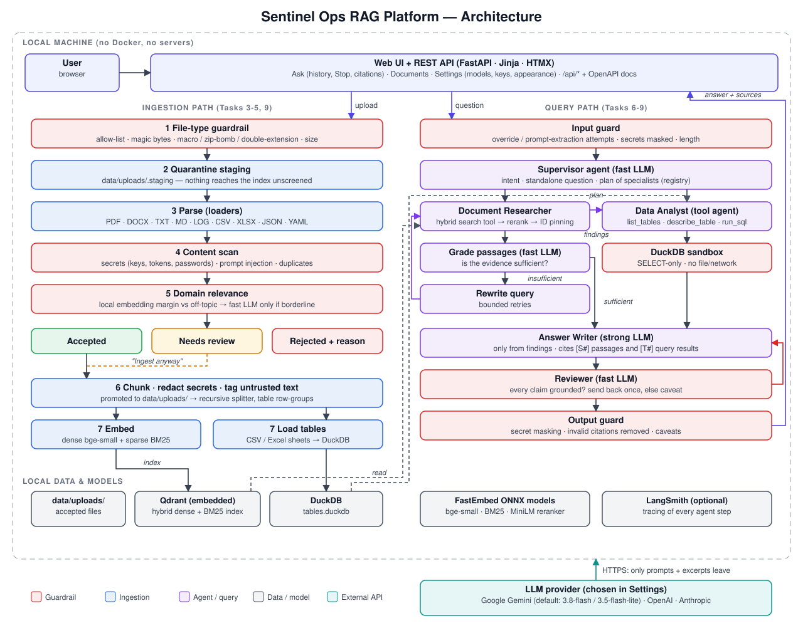
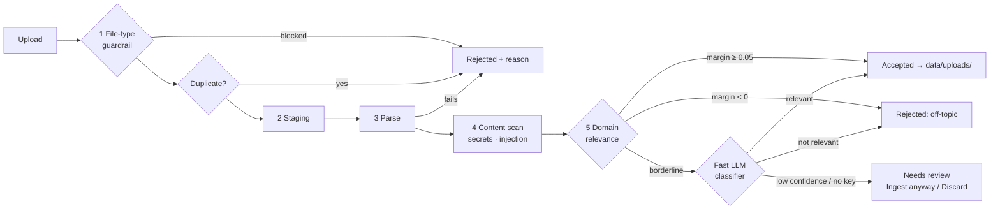
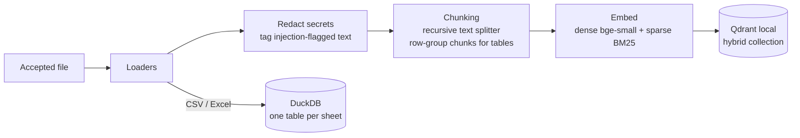
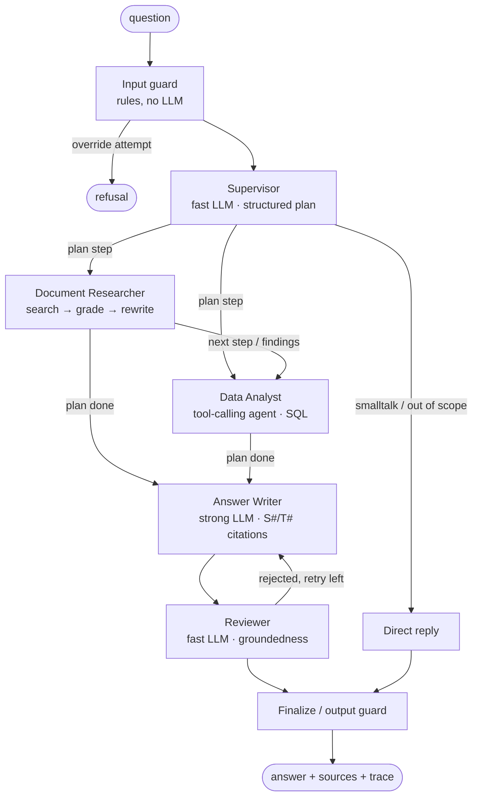
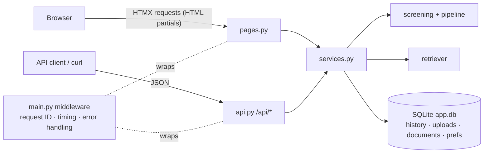

# Architecture — Sentinel Ops RAG Platform

An agentic, corrective RAG system for IT operations, security and governance
knowledge (10 subject areas, listed under [Upload screening](#upload-screening)):
runbooks, postmortems, policies, cloud configs, SIEM alert exports,
vulnerability scans, change records and deployment logs.



*Regenerate with `python -m scripts.draw_architecture`.*

## Design principles (from the October 2026 state of practice)

| Principle | Why | Where |
|---|---|---|
| **Hybrid retrieval** (dense + BM25, RRF fusion) | Ops text is full of exact tokens (CVE IDs, error codes, hostnames) that dense embeddings blur; BM25 catches them. | `src/retrieval` |
| **Cross-encoder reranking** | Cheapest large gain after hybrid search: over-fetch 20, keep the best 5. | `src/retrieval` |
| **Corrective RAG loop** | A fast model grades retrieved chunks; if they don't answer the question, rewrite the query and retry (bounded). | `src/agents/graph.py` |
| **Text-to-SQL for tables** | Embedding CSV rows can't answer "how many open criticals per team"; DuckDB gives exact aggregates. | `src/tables`, Data Analyst agent |
| **Supervisor + specialist agents** | Each agent has one capability and its own tools; a supervisor plans their order and later agents receive earlier findings. | `src/agents/registry.py`, `graph.py` |
| **Two-tier models** | Cheap model for planning/grading/review, strong model for analysis and writing; a circuit breaker drops to the fast model when the strong one is overloaded. Models and providers are chosen in Settings. | `src/llm.py`, `src/model_registry.py` |
| **Reviewer (grounding check)** | Every claim in the answer must be supported by a cited source; otherwise the writer revises once, then a caveat is shown. | Reviewer agent |
| **Defense against indirect prompt injection** | OWASP LLM01: uploaded documents are untrusted input. Chunks are scanned at ingestion and wrapped as data, never instructions. | `src/guardrails` |
| **Secret redaction** | Ops docs routinely contain keys and passwords; they are masked before indexing and before display. | `src/guardrails` |
| **Fully local data plane** | Embedded Qdrant + DuckDB + ONNX models: no Docker, no servers, only the LLM call leaves the machine. | — |

## Upload screening

Every upload passes through `src/ingestion/screening.py` before it can be
indexed. Files are held in a quarantine folder (`data/uploads/.staging`) and
only promoted to `data/uploads/` when accepted.



### 1. File-type guardrail (`src/guardrails/file_validation.py`)

| Accepted | Category | Typical content |
|---|---|---|
| `.pdf` | document | Security policies, standards, audit reports, vendor advisories |
| `.docx` | document | Runbooks, SOPs, design docs, postmortems |
| `.md`, `.txt` | document | Wiki pages, playbooks, notes |
| `.log` | log | Application, audit and system logs |
| `.csv`, `.xlsx` | tabular | SIEM alerts, scan results, asset inventories, risk registers |
| `.json` | structured | Cloud configs, IAM policies, SIEM/scanner exports (JSON or JSON Lines) |
| `.yaml`, `.yml` | structured | Kubernetes manifests, CI/CD pipelines, Ansible playbooks |

| Blocked | Reason |
|---|---|
| `.doc`, `.rtf`, `.odt`, `.xls`, `.ods` | Legacy/other office formats; the user is told to save as `.docx`/`.xlsx`/PDF |
| `.docm`, `.xlsm`, `.pptm`, … | Macro-enabled |
| `.exe`, `.dll`, `.ps1`, `.sh`, `.js`, `.jar`, … | Executables and scripts |
| `.zip`, `.rar`, `.7z`, `.tar`, `.gz`, … | Archives (zip bombs, hidden content) |
| `.png`, `.jpg`, `.tiff`, … | Images; OCR is out of scope |

Beyond the extension, the bytes must match the claimed type:

- **PDF:** must start with `%PDF-`, must not be password-protected, has a page limit, and must contain extractable text (scanned PDFs are rejected).
- **DOCX/XLSX:** must be a real OOXML zip with the expected parts. It is rejected if it contains `vbaProject.bin` (macros) or expands more than 100× or beyond 250 MB (zip bomb).
- **Text formats:** must be UTF-8 or Windows-1252 with no binary content. JSON, JSON Lines and YAML must parse (YAML via `safe_load`), and CSV needs a header plus at least 2 columns.
- **Filename:** path components are stripped and characters normalised. Hidden files are rejected, as are double extensions hiding an executable (`invoice.exe.pdf`).
- **Other checks:** a size limit, rejection of empty files, and SHA-256 duplicate detection.

### 4. Content scan (`src/guardrails/content_scan.py`)

- **Secrets:** AWS keys, GitHub/Slack/Google tokens, private keys, JWTs, credentials in connection strings, and `password=`-style assignments. The scan reports them at upload time and masks them (`[REDACTED_AWS_ACCESS_KEY]`) before indexing.
- **Prompt injection:** phrases such as "ignore previous instructions", hidden `<!-- SYSTEM` comments, and "you are now…". Matching text is flagged, and those chunks are indexed as untrusted. They are not rejected, because security documents legitimately discuss these attacks.

### 5. Domain relevance (`src/guardrails/relevance.py`, `domains.py`)

The platform accepts ten subject areas, each defined in `domains.py` with a
description, example sentences and keywords:

| Key | Domain |
|---|---|
| `devops` | DevOps & SRE: CI/CD, deployments, Kubernetes, IaC, monitoring, runbooks, postmortems |
| `governance` | IT governance, compliance & code security: policies, audits, ISO 27001/SOC 2/PCI/NIST/GDPR, secure coding, AppSec |
| `cloudops` | CloudOps: AWS/Azure/GCP accounts, IAM, compute, storage, landing zones, cloud security posture |
| `secops` | SecOps: SIEM, detection, incident response, threat intel, MITRE ATT&CK, vulnerability management |
| `itsecurity` | IT security: identity & MFA, endpoint/network security, encryption, secrets, data protection |
| `itsm` | IT service management (ITIL): incident/problem/change management, CAB, service desk SLAs, CMDB |
| `ai_governance` | AI / LLM governance & security: AI policies, model risk, LLM security, NIST AI RMF, EU AI Act, ISO 42001 |
| `finops` | FinOps: cloud spend, cost allocation and tagging, rightsizing, savings plans, showback/chargeback |
| `resilience` | Business continuity & resilience: BIA, DR plans and tests, backups, RTO/RPO, crisis management, DORA |
| `netops` | Network operations: routing, firewall rules, VPN, DNS, load balancers, SD-WAN, network changes |

A file is tagged with up to 3 domains, ranked by mean embedding similarity plus
0.02 per keyword hit (capped at 5 hits). Domains within 0.025 of the top score
are kept. The keyword term matters for terse files such as YAML manifests,
where embeddings alone barely separate the subjects. The tags describe the
file and are not used to decide acceptance.

**Stage 1 (local and free).** The scan takes six evenly spaced excerpts and embeds them. Each excerpt is scored by its best similarity to the domain prototypes **minus** its best similarity to off-topic prototypes (HR, finance, sales, sports, food, medicine, …). The file's margin is the average over the most on-topic half of the excerpts.

Contrastive scoring is needed because absolute similarity does not separate the two classes. With bge-small, an HR leave policy (0.635) and a sales table (0.650) score higher than a valid Kubernetes manifest (0.613). The margin separates them on the calibration set
(10 domains; measured 2026-10-25):

| | Lowest margin | Highest margin |
|---|---|---|
| On-topic (24 docs: 9 sample-corpus files, 2 texts per new domain, IAM JSON, K8s YAML, nginx log, AUP, GDPR procedure) | +0.056 (nginx log) | +0.427 |
| Off-topic (14 docs: recipe, football, HR leave, payroll, P&L, invoice, sales, marketing, medical, travel expenses, code of conduct, facilities helpdesk, syllabus, property listing) | −0.179 | +0.020 |

No off-topic document is auto-accepted. The three nearest (invoice, facilities
helpdesk and travel-expense policy, at 0.000 to +0.020) fall in the borderline
band and go to the LLM, or to *needs review* when no API key is set. These
cases are pinned by `test_near_miss_never_auto_accepted`.

**Stage 2 (only for borderline files, margin between 0 and 0.05).** The fast LLM classifies the excerpts using structured output (`relevant`, `domains`, `confidence`, `reason`). The excerpts are wrapped as untrusted data. A confidence below 0.6, a missing API key or an LLM error all result in **needs review**.

Adding a new subject area means adding one `Domain` entry. Re-run the
calibration tests (`tests/test_screening.py`) afterwards.

## Ingestion pipeline (after acceptance)



## Retrieval (Tasks 4-6)

### Chunking (`src/ingestion/chunking.py`)

| Content | Strategy |
|---|---|
| PDF, DOCX, TXT, MD, LOG | Recursive splitter preferring Markdown headings, then paragraphs, lines and sentences; 1000 characters with 150 overlap |
| JSON, YAML | Splits on YAML document breaks (`---`) and blank lines |
| CSV, Excel | One schema chunk per table (name, row count, columns), plus row groups that fit the chunk size. Each group repeats the table name and **its own row range** |

Every chunk:
- starts with a source header (`Source: information_security_policy.pdf (page 1)`), which is embedded with the text and used for citations
- has its secrets masked
- carries `untrusted=true` when it contains a suspected prompt injection
- gets a deterministic UUID derived from the file hash, its position and its content, so re-indexing a file is idempotent

### Vector store (`src/vectorstore/store.py`)

The store is embedded Qdrant (`data/qdrant/`), so there is no server. Each chunk is stored with two named vectors:

| Vector | Model | Purpose |
|---|---|---|
| `dense` | `BAAI/bge-small-en-v1.5` (384-d, cosine) | Meaning and paraphrases |
| `sparse` | `Qdrant/bm25` with Qdrant's **IDF modifier** | Exact tokens: CVE IDs, hostnames, error codes, ticket numbers |

Hybrid search runs both branches with a candidate limit of 2 × `FETCH_K` each and fuses
them with Reciprocal Rank Fusion. The store is written directly on
`qdrant-client`, not through the LangChain wrapper, for two reasons: it allows
separate prefetch limits, and it makes the dense-only and BM25-only modes
available for evaluation.

CSV and Excel files are **also** loaded into DuckDB (`data/tables.duckdb`), one
table per sheet, for exact aggregate questions. Vector search over rows can
find a row, but it cannot count rows. The DuckDB connection is sandboxed:
- external access is disabled and the configuration locked, so reading files or URLs, `COPY`, `ATTACH` and `INSTALL` are all blocked
- exactly one `SELECT` statement is accepted, checked with DuckDB's own parser
- internal tables are hidden
- results are capped at 200 rows, and queries are interrupted after 10 s

### Retriever (`src/retrieval/retriever.py`)

```
query → hybrid search (FETCH_K=20) → cross-encoder rerank → identifier pinning → TOP_K=5
```

**Identifier pinning.** In evaluation, the cross-encoder reranker ranked a SIEM row containing the
exact IP in the query *below* similar-looking rows and dropped it from the top
5. Cross-encoders don't treat IDs as must-match tokens. When the query contains
identifiers, chunks containing them verbatim are now ranked first, and the
reranker orders within each group. The identifiers recognised are CVE IDs,
IPv4 addresses, `INC-`/`DEP-`/`CHG-`/`VULN-` style tickets, ATT&CK technique
IDs, semantic versions and hostnames.

### Retrieval evaluation (`src/evaluation/retrieval_eval.py`)

The golden set has 24 questions (`data/eval/retrieval_golden.yaml`): 19
paraphrased and 5 identifier queries. A hit requires the **answer-bearing
chunk** in the top k, not just the right file. Results on CPU (Apple
Silicon), 2026-10-26:

| Config | hit@1 | hit@5 | MRR@5 | hit@5 identifier | hit@5 paraphrase | ms/query |
|---|---|---|---|---|---|---|
| Dense only | 50% | 71% | 0.56 | 40% | 79% | 3 |
| BM25 only | 62% | 100% | 0.80 | 100% | 100% | 1 |
| Hybrid (RRF) | 67% | 100% | 0.77 | 100% | 100% | 4 |
| Dense + rerank | 75% | 92% | 0.82 | 60% | 100% | 420 |
| **Hybrid + rerank + pinning** | **83%** | **100%** | **0.91** | **100%** | **100%** | 418 |

Decisions this evaluation supported:
- **Hybrid over dense-only.** Dense-only search misses 3 of the 5 identifier queries.
- **Reranker model.** `ms-marco-MiniLM-L-6-v2` matched `L-12` in quality (MRR 0.91 vs 0.89, within the noise of 24 questions) at about half the latency (418 ms vs ~800 ms), so L-6 is the default.
- **Identifier pinning.** Without it, hybrid + rerank scored hit@5 96% and MRR 0.84.

BM25 alone scores well here because the questions share vocabulary with a
small, clean corpus. Dense search contributes on real-world paraphrase, and
the reranker contributes on ranking quality (hit@1 rises from 62% to 83%).

## Multi-agent workflow (Tasks 7-8)

A **supervisor** plans and a team of **specialist agents** does the work, each with its own capability, tools and
prompt. Specialists are declared in a capability registry (`src/agents/registry.py`); the supervisor's planning
prompt is generated from it, so adding a specialist means one registry entry plus one node.



### Agent roles

| Agent | Model | Tools | Responsibility |
|---|---|---|---|
| **Supervisor** | fast | — | Classifies intent (answer / smalltalk / out-of-scope), rewrites follow-ups into a standalone question using the last 6 turns, and produces an ordered plan of up to 3 specialist steps. Unknown specialists, and the analyst when no tables are in scope, are removed from the plan. |
| **Document Researcher** | fast | `search_documents` (hybrid search → rerank → ID pinning) | Corrective RAG loop: search, grade the passages (structured `Grade`), and if the evidence is insufficient rewrite the query and search again, at most `MAX_RETRIEVAL_RETRIES` times. Keeps only the passages graded relevant. |
| **Data Analyst** | strong | `list_tables`, `describe_table`, `run_sql` | LangChain `create_agent` tool loop over the sandboxed DuckDB. It sees only the tables of documents in scope, receives earlier findings as context (for example an SLA from the policy), and when SQL fails it reads the error and fixes the query. Every query and its result is recorded. |
| **Answer Writer** | strong | — | Writes the answer only from numbered sources: `S#` passages and `T#` query results. Cites every fact and says "I couldn't find this in your documents." when the evidence is missing. Sources are framed as untrusted data. |
| **Reviewer** | fast | — | Checks groundedness and whether the question is answered (structured `Review`). A rejected answer goes back to the writer with feedback, at most `MAX_ANSWER_RETRIES` times. |
| Input / output guards | — | — | Before: override and prompt-extraction attempts are blocked (quoted text is exempt), secrets are masked, length is limited. After: secrets are masked, citations to non-existent sources are removed, and caveats are added. |

**Collaboration example.** "How many open critical findings are past their SLA, and what does the policy say?"
runs as follows:
1. The supervisor plans the researcher, then the analyst.
2. The researcher finds "Critical: 7 calendar days".
3. The analyst receives that note and runs `SELECT COUNT(*) … WHERE sla_due < CURRENT_DATE`.
4. The writer cites both (`[S1]`, `[T1]`), and the reviewer approves.

**Shared state (`src/agents/state.py`).**
- Contents: question, history, scope, plan, `findings[]` (one per specialist step), sources, answer, review, caveat, and `trace[]`.
- Every agent appends a trace step (`agent`, `action`, `detail`, `ms`). The UI shows these under *Technical details → How this answer was produced*, and the chat shows "Answered by …".
- All prompts are in `src/agents/prompts.py`.

**Failure behaviour (graceful degradation).** All LLM calls go through `retry_transient` (`LLM_RETRY_ATTEMPTS`, default 4, with backoff 2 s, 4 s, 8 s); the strong model gets 2 attempts before the circuit breaker switches the request to the fast model.

| Failure | Behaviour |
|---|---|
| Supervisor fails | Default plan: the researcher answers the question as asked |
| Grader fails | All retrieved passages are kept |
| Analyst fails | Retried like every other call (strong model twice, then the fast model with full retries); only a persistent failure yields a finding with the error, and the writer uses the other findings |
| Reviewer fails | The answer is shown with "could not be checked automatically" |
| Writer fails | The web layer shows the most relevant passages instead, with a notice and a reference ID |
| Runaway loops | Prevented by `AGENT_RECURSION_LIMIT` and the bounded retry counts |
| User presses Stop | The browser posts the question's token to `/ask/stop`; the server sets that question's cancel event and the workflow raises `CancelledError` before its next agent step (at most one in-flight model call completes). A "Stopped" turn is recorded in the history. |
| User leaves the page mid-answer | Nothing is cancelled: the agents finish in the worker thread and the answer is saved to the conversation. The Ask tab returns to that conversation; if the answer is still being written it shows a notice and polls `/c/{id}/wait`, refreshing when ready. |

**Testing without an API key.** `tests/fakes.py` provides `ScriptedChatModel`, a real LangChain
`BaseChatModel` whose replies are scripted per call. Structured output and the `create_agent` tool loop therefore
run through LangChain's own code paths. The agent tests (`tests/test_agents.py`) cover:
- the full document flow and the corrective retry, including its bound
- the analyst's tool loop and SQL error recovery
- researcher → analyst collaboration
- direct replies
- dropping invalid plan steps
- follow-up questions using chat history
- reviewer rejection and the persistent-rejection caveat
- secret masking in answers
- fast-model outage and writer failure

## Web interface and API (Task 2)



- **Server-rendered UI.** FastAPI renders Jinja templates. HTMX 2 (bundled locally) swaps partial HTML for chat
  turns, uploads and deletions, and out-of-band swaps refresh the History sidebar and conversation ID. There is
  no Node or build step, and the whole frontend is one CSS file plus about 150 lines of JavaScript.
- **One service layer.** The pages and the REST API call the same `services.py`, so behaviour is identical.
  OpenAPI docs are at `/api/docs`.
- **Plain language first.** `presenters.py` turns internal results into user wording (friendly file names,
  "Added / Not added / Needs your confirmation", "passwords were hidden"). Scores, file names, chunk IDs and
  error codes go into collapsed *Details* or *Technical details* sections, and a setting can hide them.
- **Appearance.** CSS variables define the light and dark palettes, three font stacks (Modern / Classic /
  Mono, system fonts only) and three text sizes. `data-theme`, `data-font` and `data-size` are set on `<html>`
  before first paint from `localStorage`, and `system` follows `prefers-color-scheme`. The layout is responsive,
  and the sidebar becomes a slide-in drawer on phones.
- **Long-running questions.** `/ask` runs the agents in a worker thread and registers the question in an
  in-flight table keyed by a client-generated token. The **Stop** button posts that token to `/ask/stop`, which
  sets the cancel event; the workflow raises `CancelledError` before its next step. Leaving the page does not
  cancel: the answer is finished and saved, and a revisited conversation polls until it is ready. The UI shows
  elapsed seconds and a status that changes with time.
- **Settings page.** Appearance, the technical-details switch, the AI-answers switch, provider keys, model
  choice with live model lists and a *Test models* action, history deletion, and collapsed system details and
  recent problems. Every control has an ⓘ tooltip (`data-tip`, pure CSS).
- **Safety.**
  - Jinja auto-escaping is on, and answer Markdown is rendered with raw HTML disabled.
  - The server binds to `127.0.0.1` by default. This is a single-user local app with no login.
  - Uploads are read with a size cap before screening.
  - Embedded Qdrant calls are serialised with a lock, because requests run in a thread pool.

## Model selection (Settings)

`src/model_registry.py` declares the providers (Google Gemini, OpenAI, Anthropic): the LangChain prefix,
the key variable, and a models endpoint. The Settings page fetches each provider's current chat models
with the user's key (cached 10 minutes, filtered to chat-capable models, newest first) and falls back to a
short built-in list offline. The chosen *answer* and *fast* models are stored as preferences in `app.db`
and override the `.env` defaults (`src/llm.py: effective_models`); keys entered in the UI are written to
`.env` by `src/env_file.py` (other lines preserved, file mode 0600) and applied to the running process, and
the per-model client cache is cleared. All providers go through LangChain's `init_chat_model`, so the agents
are provider-agnostic. **Test models** sends a one-word prompt to each selected model and reports the time
or the classified error. An **AI answers** switch turns generation off without removing keys, in which case
the chat shows passages.

## Error handling and logging

**Error model (`src/errors.py`).** Every exception that reaches a request boundary is converted to an
`AppError` by `classify_exception`. Third-party errors are recognised by type, status code or message:
Qdrant folder lock, DuckDB, SQLite, Gemini 429, 401/403 or "model not found", timeouts and connection errors.

| Severity | Log level | Shown as | Examples | HTTP |
|---|---|---|---|---|
| info | INFO | blue notice | empty question, invalid request body | 400 / 422 |
| warning | WARNING | amber notice; `retryable` when transient | rate limit, network timeout, AI not configured, not found | 429 / 503 / 404 |
| error | ERROR + traceback | red notice | bad API key, model unavailable, storage or unexpected error | 500 / 502 |
| critical | CRITICAL + traceback | red banner | invalid configuration, knowledge base locked by another process | 500 / 503 |

How errors are handled at each boundary:
- **Request middleware.** Catches unexpected exceptions, so each error is logged exactly once with a
  reference ID. Users see the message, hint, reference and request ID, never a traceback.
- **HTMX responses.** Errors are re-targeted to a notification area (`HX-Retarget: #flash`), so a failed
  action never replaces page content.
- **API responses.** Errors return `{"error": {...}}` with the HTTP status above.
- **Retries.** `retry_transient` retries rate limits and timeouts with exponential backoff (1 s, 2 s, 4 s…),
  ready for the LLM calls in Tasks 7–8.
- **Batch uploads.** Each file is handled in isolation, so one corrupt file does not fail the batch.

**Logging (`src/logging_setup.py`).**

| Handler | Level | Purpose |
|---|---|---|
| console | `LOG_LEVEL` | Developer view |
| `logs/app.log` | `LOG_LEVEL` | Full history, including one line per request (`GET /documents -> 200 (34 ms)`) |
| `logs/errors.log` | WARNING+ | Problems only, with tracebacks; shown in Settings → Recent problems |
| `logs/audit.log` | INFO (`sentinel.audit`) | Security trail: uploads accepted, rejected or needing review, secrets detected, injection flagged, documents indexed or removed, SQL rejected |

The rotation policy applies to every file:
- `LOG_ROTATION=size`: `RotatingFileHandler`, rotates at `LOG_MAX_MB`
- `LOG_ROTATION=time`: `TimedRotatingFileHandler`, rotates every `LOG_ROTATE_WHEN`
- `LOG_ROTATION=off`: no rotation

`LOG_BACKUP_COUNT` sets how many files are kept. `LOG_FORMAT=json` emits one JSON object per line.
A filter on every handler adds the request ID and masks secrets (API keys, tokens, passwords,
connection strings) before anything is written, including inside tracebacks. Noisy libraries
(httpx, fastembed, Hugging Face) are capped at WARNING. Configuration is validated at startup;
for example, `LOG_ROTATION=weekly-ish` raises a critical `ConfigError` naming the bad value.

## Guardrails (Task 9)

| Layer | Control |
|---|---|
| Upload: type | Extension allow/block lists, magic-byte checks, macro and zip-bomb detection, size/page limits, filename sanitising, duplicates. **Implemented.** |
| Upload: topic | Two-stage domain relevance screening (embedding margin, then LLM for borderline files) with quarantine staging. **Implemented.** |
| Ingestion | Secret masking in every chunk; prompt-injection pattern scan, with flagged chunks stored as `untrusted=true` and labelled in the UI. **Implemented.** |
| Question | `src/guardrails/query_guard.py`: blocks instruction-override and prompt-extraction attempts (text in quotes is exempt, so analysts can ask *about* injection), masks secrets typed into questions, limits length. Out-of-scope requests are refused by the supervisor. Blocked questions are written to the audit log and never reach a model. **Implemented.** |
| Prompting | Retrieved passages and table rows are wrapped in `<source … trust="untrusted">` tags, and every prompt says to ignore instructions inside them. **Implemented.** |
| SQL tool | DuckDB sandbox (external access off and locked), a single SELECT checked by DuckDB's parser, internal tables hidden, row cap, timeout. **Implemented.** |
| Answer | Reviewer agent checks groundedness with one revision. Mandatory `[S#]`/`[T#]` citations; invalid ones are removed. An explicit "couldn't find this" when evidence is missing, secret masking on output, and caveats when unverified or uncited. **Implemented.** |
| Runtime | Retries with backoff on transient LLM errors, `LLM_TIMEOUT_S`, `AGENT_RECURSION_LIMIT`, bounded research and revision loops. Falls back to showing passages if answer generation fails. **Implemented.** |

## Evaluation (Task 10)

- **Retrieval:** implemented. See [Retrieval evaluation](#retrieval-evaluation-srcevaluationretrieval_evalpy).
- **Answers:** `python -m src.evaluation.answer_eval` (needs the API key) runs 13 golden questions
  (`data/eval/answer_golden.yaml`). They cover document facts, table questions, a researcher + analyst
  collaboration, a question not covered by the documents, an out-of-scope request and a blocked override.

  Deterministic metrics:
  - fact recall
  - numeric accuracy, with the truth computed live by `truth_sql` against DuckDB, so it can't drift from the data
  - source hit rate
  - intent and routing accuracy
  - citation rate

  LLM-judged metrics (RAGAS-style, fast model as judge):
  - faithfulness
  - answer relevance

  Results are saved to `data/eval/results/` together with the models in use. The harness itself is tested
  with scripted models. **Status:** the harness is complete; the numbers from a live run will be recorded here
  once the evaluation has been run with the final models.

## Limitations

- Scanned (image-only) PDFs are not OCR'd, and legacy `.doc`/`.xls` files are not accepted.
- The relevance thresholds were calibrated on a small set (38 documents). Very short or highly mixed documents can land in *needs review*, and terse logs sit closest to the accept threshold (nginx access log: +0.056).
- Pattern-based secret and injection detection catches common formats only, so it reduces risk but does not eliminate it.
- The web app is single-user with no authentication and binds to localhost; multi-user use would need login, per-user history and Qdrant server.
- Local embedded Qdrant is single-process; a multi-user deployment would use Qdrant server. Running the CLI ingest while the app is open fails with a folder-lock error.
- The retrieval golden set is small (24 questions over a synthetic corpus), so the numbers compare configurations but say little about absolute quality on real data.
- Reranking costs about 0.4 s per query on CPU, which is most of the retrieval latency.
- Table rows are both embedded and loaded into DuckDB. Very large spreadsheets (100k+ rows) would need sampling or SQL-only handling.
- LLM-judged metrics depend on the judge model and are indicative, not absolute.
- The agent flow is fully tested with scripted models but still has to be validated and its prompts tuned against Gemini; answer-quality numbers will be added after `answer_eval` runs with a real key.
- Each question makes 4–6 LLM calls (plan, grade per research round, write, review, plus analyst tool turns), so answers take several seconds and use free-tier quota quickly. When Google reports the strong model overloaded (503/504), the first attempt can take up to a minute before the circuit breaker switches the request to the fast model. Answers are not streamed yet; the UI shows elapsed time and a Stop button instead.
- Pending uploads awaiting "Add anyway" live in process memory and are lost on restart; the staged file stays in `.staging` until the next upload of the same file.
- The question guard is pattern-based; a determined attacker can phrase around it. The untrusted-source framing and the reviewer are the second and third lines of defence.
- Model lists in Settings depend on each provider's models API and are filtered by name patterns; a new model type could be hidden or an unsuitable one shown. *Custom…* and *Test models* cover that case.
- Keys entered in Settings are stored in plain text in `.env` (mode 0600), which is appropriate for a single-user local tool but not for a shared server.
- Only one process can open the embedded index, so evaluations and CLI indexing require stopping the app.
- The project's Gemini key is on Google's free tier: at the time of writing `gemini-3.8-flash` allows 20 requests per day and `gemini-3.5-flash-lite` 15 per minute. A question uses 1–2 answer-model calls, so roughly 10 questions a day are possible on the default model before switching the *Answer model* in Settings (or enabling billing). The answer evaluation therefore runs with `gemini-3.5-flash-lite` for both roles.

## Challenges faced

| Challenge | What happened | Resolution |
|---|---|---|
| Choosing current models | Research showed `gemini-2.5-flash`, the planned default, had been retired for new users. | Gemini 3.8 Flash / 3.5 Flash-Lite, all model IDs configurable in `.env`, and a setup check that calls each model. |
| Topic screening of uploads | Absolute embedding similarity rated an HR leave policy (0.635) and a sales table (0.650) as *more* relevant than a real Kubernetes manifest (0.613). | Contrastive scoring against off-topic prototypes, with the decision on the margin. Off-topic and on-topic now separate cleanly, and borderline files go to the LLM. |
| Reranker vs exact IDs | The cross-encoder pushed the SIEM row with the exact IP from the question out of the top 5. | **Identifier pinning**: chunks containing the question's CVE/IP/ticket IDs are ranked first. Hit@5 went from 96% to 100% and MRR from 0.84 to 0.91. |
| SQL written by an LLM | A query that is "only a SELECT" can still read files (`read_csv('/etc/passwd')`) or install extensions. | DuckDB external access is disabled and the configuration locked, plus a single-SELECT check with DuckDB's own parser, row caps and a timeout. Tests prove file reads are blocked. |
| Prompt injection vs security content | SecOps documents legitimately discuss prompt injection, so rejecting them would lose real knowledge. | Flag instead of reject: chunks are marked `untrusted`, prompts treat all sources as data, and the question guard ignores quoted text. |
| Embedded vector store | Embedded Qdrant allows one process and is not built for concurrent threads, which caused lock errors while the old app was still running. | A process-wide store with a thread lock, a clear critical `STORE_LOCKED` message with a fix hint, and a single entry point for the CLI. |
| Testing agents without an API key | There was no key during development, but the agent logic needed proper tests. | `ScriptedChatModel`, a real `BaseChatModel` with scripted replies, so structured output and the tool-calling agent run through the real LangChain code. 199 tests run offline. |
| Library churn | `langchain-community` is being sunset, and Streamlit limited the UX the project needed. | A small FastEmbed adapter in `src/llm.py`, and a move to FastAPI + HTMX with a REST API. |
| Stale browser assets | Users saw old behaviour after updates because static files were cached by app version. | Content-hash asset URLs (`app.js?v=<sha>`). |
| Provider overload | On the first live day Google returned 503/504 for `gemini-3.8-flash`; one question took 279 s and the analyst step failed outright. | 503/504 classified as transient; a per-request circuit breaker switches to the fast model after two failed attempts (also for the analyst); the UI shows elapsed time with a **Stop** button that cancels the agents server-side. |
| Questions that cannot be stopped | A slow question left the user waiting with no control, and abandoning the page did not stop the API calls. | Cooperative cancellation: the handler watches for the client disconnect and sets an event the workflow checks before every step. |
| Finder side effects | Browsing the sample folder in the file picker created a hidden `.DS_Store`, which "Try sample documents" and 26 tests picked up as a document. | One `sample_documents()` helper that ignores hidden files, used by the app, the generator and the tests. |
| Hardcoded models | Model IDs retire; a fixed dropdown would go stale within months. | Model lists fetched live from each provider's models API with the user's key, cached, with a built-in fallback and a *Custom…* entry. |

## Future work

See [ROADMAP.md](ROADMAP.md): deployment (Docker image, Qdrant service, authentication, CI), answer
quality and cost, new agent capabilities, knowledge management, user experience, security and
compliance, and observability, with a suggested order.
